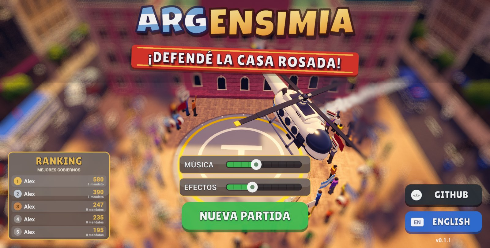
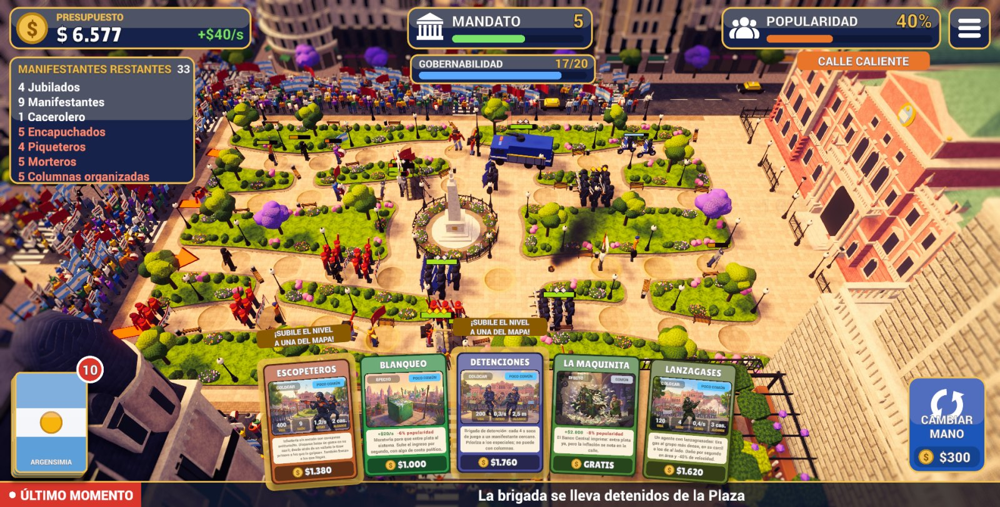
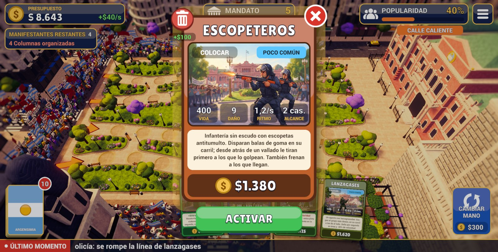
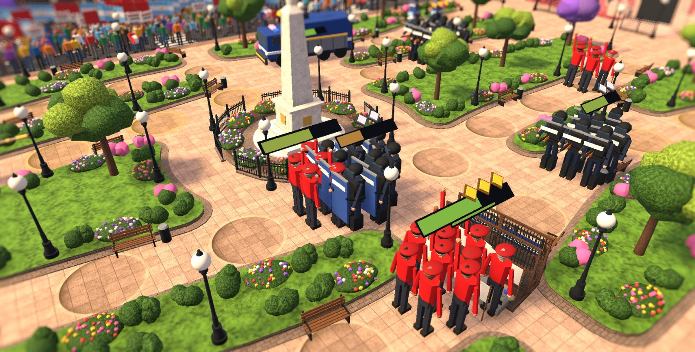

# ARGENSIMIA

**Tower defense satírico en la Plaza de Mayo.** Defendé la Casa Rosada con la policía frente a columnas de manifestantes, mandato tras mandato, mientras manejás el presupuesto, la popularidad y un mazo de medidas de gobierno.

> *Satirical tower defense set in Buenos Aires' Plaza de Mayo. Defend the Casa Rosada term after term while juggling budget, popularity and a deck of government measures. Available in Spanish and English.*

## Descargar

Última release: **[v0.2.1](https://github.com/alexander171294/Argensimia/releases/latest)**: progresión entre partidas con 10 defensas desbloqueables y logros.

| Plataforma | Archivo | Cómo se instala |
| --- | --- | --- |
| Windows 10/11 (64 bits) | `Argensimia-0.2.1-Windows-Setup.exe` | Instalador con acceso directo en el escritorio y desinstalador. Como no está firmado, SmartScreen puede pedir *Más información → Ejecutar de todas formas*. |
| macOS 11+ (Intel y Apple Silicon) | `Argensimia-0.2.1-macOS.dmg` | Arrastrá Argensimia a Aplicaciones. Está firmado ad hoc (sin notarizar): la primera vez abrilo con clic derecho → *Abrir*. |
| Linux x86_64 | `Argensimia-0.2.1-Linux-x86_64.AppImage` | `chmod +x Argensimia-*.AppImage && ./Argensimia-*.AppImage` (requiere FUSE). |

## Capturas

| | |
| --- | --- |
|  |  |

## Cómo se juega

- **Mandatos = oleadas.** Cada mandato tiene una previa de 30 segundos para jugar cartas y colocar policía; después llegan los manifestantes por los carriles de la plaza.
- **Gobernabilidad.** Cada manifestante que llega al vallado de la Casa Rosada la baja. Si llega a 0, el presidente se va en helicóptero.
- **Popularidad = dificultad.** Con poca popularidad viene más gente y más enojada (TRANQUI → TENSO → CALLE CALIENTE → ESTALLIDO). Muchas cartas dan plata a cambio de popularidad.
- **Mazo finito.** Lo que jugás se consume; al cerrar cada mandato elegís 3 cartas nuevas y podés comprar más o vender las que no te sirven.
- **Progresión entre partidas.** Cada 3 mandatos sobrevividos (sumando todas tus partidas) desbloqueás una defensa nueva para las próximas: puntero, contenedores, infiltrado, comisario, concertina, requisa, desvío, estruendo, drone y tanqueta. Con todas, cada 3 mandatos ganás una mejora permanente.
- **Logros.** 19 logros (llegar al mandato 10, detener a 500 manifestantes, usar 25 veces La maquinita…) con su panel en el menú.
- **Defensas con niveles.** Soltá una carta igual sobre una defensa del mapa para subirla a nivel 2 y 3.
- **Puntaje y ranking.** (Eliminados + dinero / 10) × mandatos jugados × popularidad. El top 5 queda en el menú.

**Policía:** vallado, infantería, escopeteros, lanzagases, detenciones, motorizada y camión hidrante.
**Manifestantes:** comunes, caceroleros, jubilados, encapuchados (saltan los retenes), piqueteros (prenden gomas), morteros y columnas organizadas.
**Cartas:** 42 entre colocables (10 se desbloquean jugando), efectos (Impuestazo, La maquinita, Plan platita, Dólar soja…), ministros pasivos y crisis forzadas (Devaluación, Paro general…).

## Tecnología

| | |
| --- | --- |
| Motor | **Unity 6000.4.1f1** (Unity 6), Universal Render Pipeline, uGUI + TextMeshPro, Input System |
| Escena | Generada por código (`Assets/Editor/PlazaBuilder.cs`); no se edita a mano |
| Modelos | Generados por código en **Blender 5.1** (`BlenderSrc/*.py`) y exportados a FBX |
| Interfaz | Toda creada en runtime (`Assets/Scripts/UI/`), mobile-first, landscape |
| Efectos de sonido | Sintetizados con numpy (`BlenderSrc/sfx_gen.py`), sin samples externos |
| Arte de las cartas | Generado con Nano Banana 2 Lite (Atlas Cloud) a partir de `docs/CARD_ART_PROMPTS.md` |
| Idiomas | Español e inglés (`Assets/Scripts/Game/Loc.cs`) |
| Plataformas | Windows, macOS y Linux (también pensado para mobile) |

El diseño completo del juego y del mapa está en [`docs/SPEC_MAPA.md`](docs/SPEC_MAPA.md).

### Abrir el proyecto

1. Instalar **Unity 6000.4.1f1** con Unity Hub (para builds: Windows/Linux Build Support (Mono)).
2. Abrir esta carpeta como proyecto y la escena `Assets/Scenes/Plaza.unity`.
3. Play. El juego arranca en el menú.

Menús del editor (`Argensimia/…`): materiales, armado de la escena, cartas y unidades, slots policiales e ícono de la app.

### Empaquetar una release

1. Builds desde Unity a `Builds/Windows`, `Builds/macOS/Argensimia.app` y `Builds/Linux`.
2. `BlenderSrc/release.py` arma el instalador de Windows (NSIS), el `.dmg` (hdiutil) y el AppImage (squashfs + runtime de AppImage) en `Release/`. Requiere `brew install makensis squashfs`.

## Créditos

- Diseño y dirección: **Alex** ([@alexander171294](https://github.com/alexander171294)).
- Desarrollado junto con **Claude (Opus 5.5)** como prueba de sus capacidades agénticas: código, modelos, sonido, arte y builds.
- Fuentes: [Luckiest Guy](https://fonts.google.com/specimen/Luckiest+Guy) (Apache 2.0), [Lilita One](https://fonts.google.com/specimen/Lilita+One) (SIL OFL) y [Roboto](https://fonts.google.com/specimen/Roboto) (Apache 2.0). Licencias en `Assets/UI/Fonts/`.

*Argensimia es una sátira. Todos los personajes son ficticios y cualquier parecido con personas reales es pura coincidencia.*
